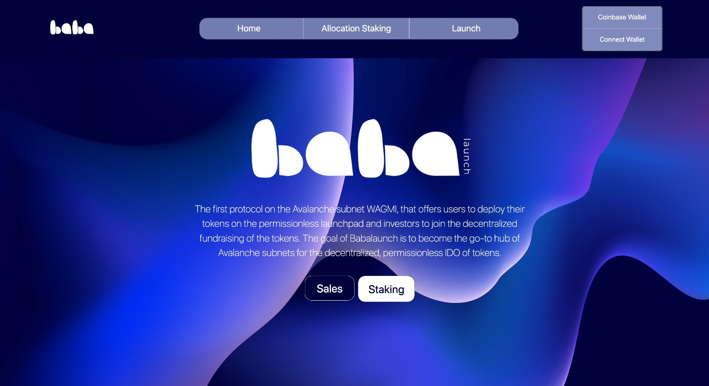
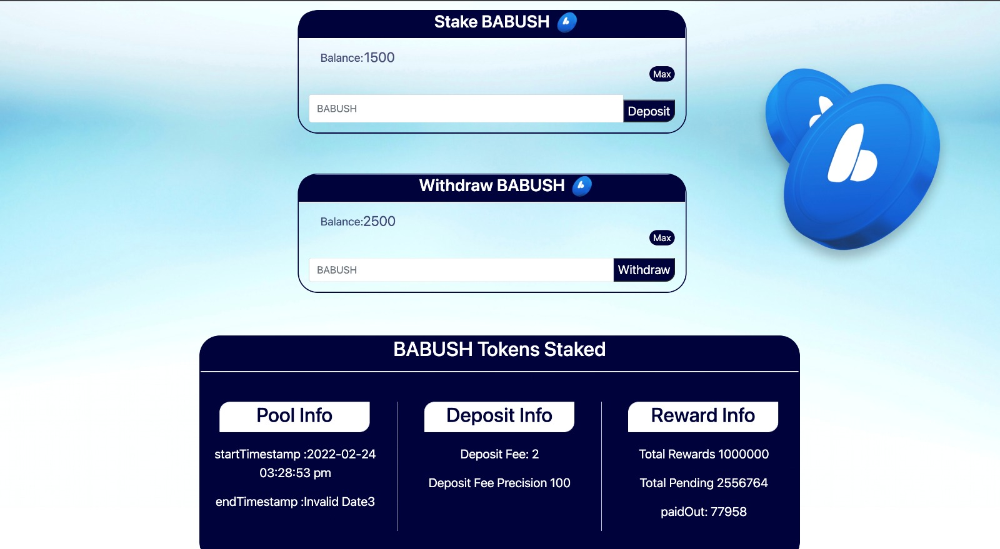
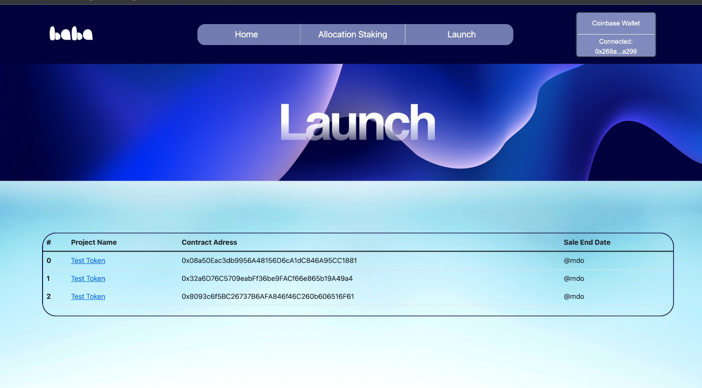
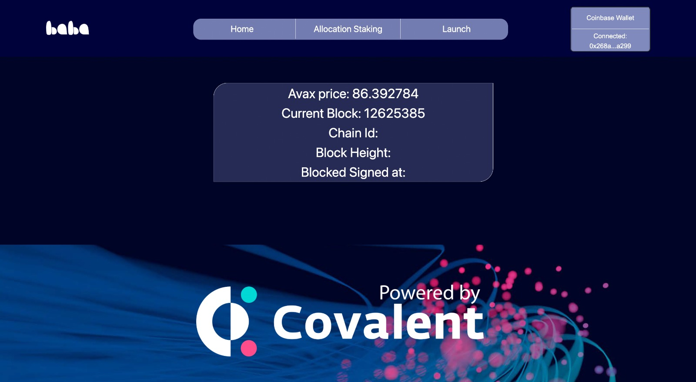
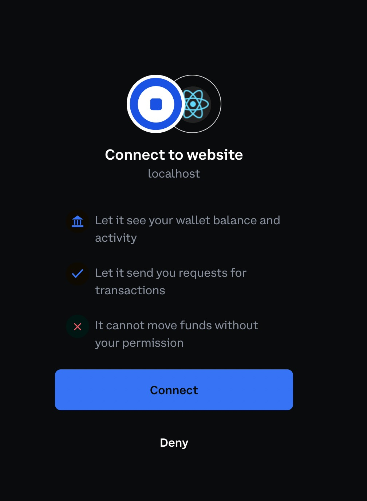
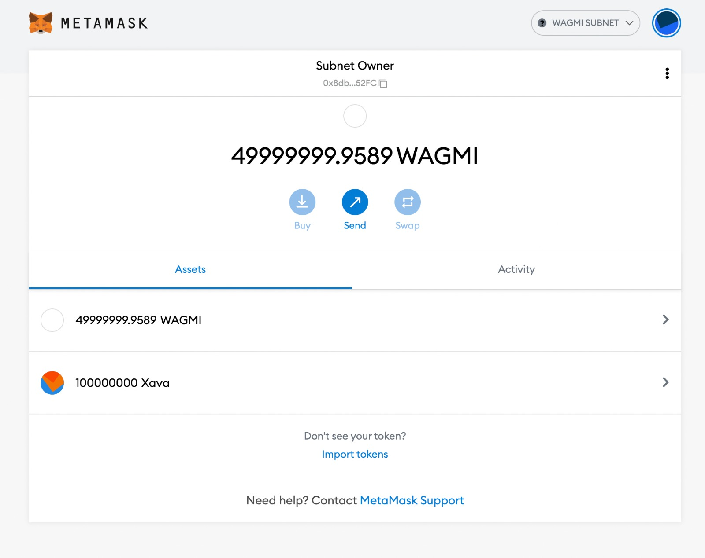
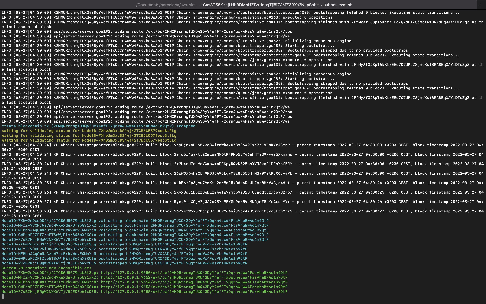

# Babalaunch

A token launchpad dApp for an Avalanche subnet. Teams create token sales through a factory contract, investors stake the platform token for allocation, then register for and join sales from a React frontend.

> **Status:** archived. Built in 2022 with a team at the Avalanche Barcelona Hackathon. Kept for reference, not maintained.



## What it does

- **Sale factory** (`hardhat-contracts/contracts/sales/SalesFactory.sol`): deploys sale contracts and lists them. The admin check on `deploySale` is disabled, so anyone can create a sale.
- **Token sales** (`AvalaunchSale.sol`): registration with an AVAX deposit (the registration signature check is commented out), sale rounds, participation at an admin-set token price in AVAX, vesting with scheduled unlock portions, and withdrawal of earnings and leftovers by the sale owner.
- **Allocation staking** (`AllocationStaking.sol`): stake and withdraw the platform token (shown as BABUSH in the UI) for rewards, with a deposit fee; registered sales can lock a staker's tokens until the sale ends.
- **Frontend** (`react-frontend/`): Home, Allocation Staking (deposit, withdraw, pool, deposit and reward info), Launch (all sales from the factory) and a project page to register, participate and withdraw earnings.
- **Covalent API**: a token info page shows the AVAX price, the latest Avalanche block and chain status.
- **Wallets**: MetaMask, plus Coinbase Wallet through the web3-react WalletLink connector.

## Screenshots














## Tech stack

- Solidity 0.6.12, Hardhat, OpenZeppelin 3.4 (including the upgradeable contracts)
- Contracts adapted from the Avalaunch (XAVA) launchpad: `AvalaunchSale`, `SalesFactory`, `AllocationStaking`, `Admin`, `XavaToken`
- Avalanche: a locally run subnet (chain ID 43214) and the Fuji testnet
- React 17, React Router, React Bootstrap
- web3.js and ethers.js, web3-react (WalletLink connector)
- Covalent API

## Running it locally

Contracts. The Hardhat config reads a deployer key from `PK` (via `.env`) for its `fuji` and `subnet` networks, so set it first:

```bash
cd hardhat-contracts
npm install
npx hardhat compile
npx hardhat test --network hardhat
```

Deployment scripts are in `hardhat-contracts/scripts/` (`XavaTokenDeploy.js`, `deploySalesFactory.js`, `addAdmin.js`, and `deploy_sales.js` with parameters in `saleConfig.json`). Contract addresses are hard-coded in those scripts and in `react-frontend/src/utils/`, so they need updating for a new deployment.

Frontend:

```bash
cd react-frontend
yarn install
yarn start
```

The Covalent API key and the Moralis node URLs in `react-frontend/src/` are placeholders (`YOUR_COVALENT_API_KEY`, `YOUR_MORALIS_KEY`). Set your own Covalent key and replace the node URLs with an Avalanche RPC endpoint you control.

## Project structure

- `hardhat-contracts/`: Solidity contracts, deploy scripts, a token test, and committed build artifacts
- `react-frontend/`: React app
- `images/`: screenshots
